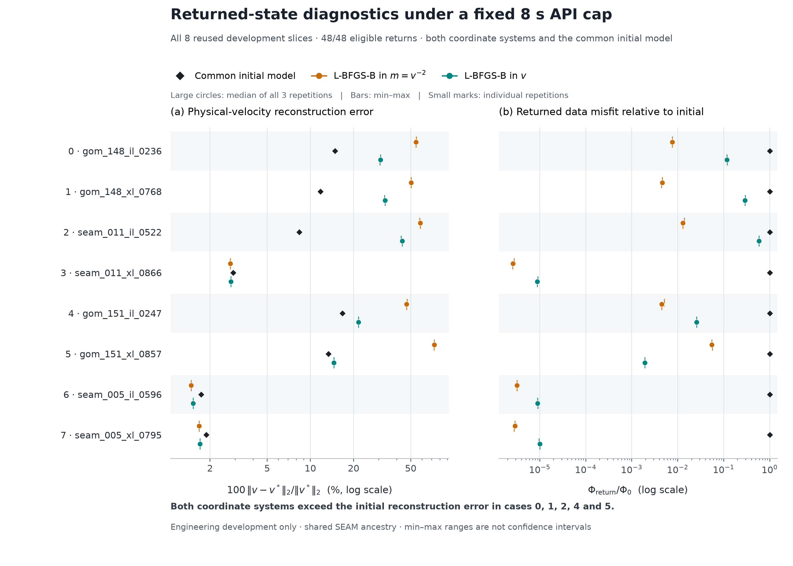

# Paired coordinate comparison at fully paid cost

Changing to physical-velocity optimizer coordinates reduces error relative to
native squared-slowness L-BFGS-B on five difficult development cases. **Both
methods still worsen reconstruction relative to initialization on those same
five cases.** The coordinate change alone does not resolve the recovery problem
in this comparison. No certificate, neural model or new optimization method is
evaluated here.

All **48 runs** (8 reused slices × 2 methods × 3 repetitions) completed and
returned within the fixed 8-second API cap. A separately implemented post-audit
passed **4,523 checks / 672 numerical comparisons**, with zero issues. All 24
pairs and all 16 case/method groups retain their full denominators; every group
has all three eligible repetitions.

## Returned reconstruction and data fit

Physical-velocity relative L2 errors below are percentages of the truth norm,
computed as `||m^(-1/2)-m_truth^(-1/2)|| / ||m_truth^(-1/2)||`. Returned values
are medians of all three repetitions. These are not the half-relative-squared
metrics from the earlier initial-direction diagnostic.

| Reused case | Common initial | Native m | Physical v |
|---|---:|---:|---:|
| `gom_148_il_0236` | 14.8732% | 54.4788% | 30.8314% |
| `gom_148_xl_0768` | 11.7568% | 50.3567% | 33.1417% |
| `seam_011_il_0522` | 8.3698% | 58.2496% | 43.5670% |
| `seam_011_xl_0866` | 2.9047% | 2.7676% | 2.7941% |
| `gom_151_il_0247` | 16.7165% | 46.7350% | 21.6459% |
| `gom_151_xl_0857` | 13.3782% | 73.0920% | 14.5837% |
| `seam_005_il_0596` | 1.7372% | 1.4750% | 1.5278% |
| `seam_005_xl_0795` | 1.8818% | 1.6791% | 1.7031% |

Both methods improve the remaining three cases, with lower median error for
native m on each. No independent-site win rate follows from this table.

Native m returns at or below both `Phi/Phi_initial=0.5` and `0.25` in **24/24**
runs. Physical v does so in **21/24** and **18/24**, respectively. These are
returned-final diagnostics: the methods do not stop at those targets, and the
recorded event is the actual API return. No first-crossing or time-to-target
claim, internal-checkpoint credit or 8-second imputation is made.

The figure shows all repetitions, their median and min–max range. Ranges are
not confidence intervals; both axes use logarithmic scales. Full caption and
all 48 rows are retained with the figure source in the artifact archive.

## Matched physical start and paid return

The existing exact cached-merit L-BFGS-B engine is used in both branches.
Each independently computes `v0=1/sqrt(requested_m)` and the canonical actual
`common_m=np.power(v0,-2)`. The native branch starts from `common_m`; the velocity
branch starts from `v0`. Their actual first paid parameter/native receipts and
observation hashes are checked. Original/requested versus actual m roundtrip
differences remain explicit; floating-point inverse bounds are not asserted to
be bitwise-identical boxes.

The same 49×49 operator, 24 blocks, inputs, bounds and optimizer settings are
retained. Fixed paired order uses seed 2026110801. Numerical `gtol=1e-10` acts
in different coordinates and is not an equal physical stationarity tolerance.
All preparation/input hashing, new observations, constructors, rejected trials,
gradient/cache work and engine finish are paid. Final velocity-to-native
conversion, model hashes, output provenance and the final counter snapshot occur
before the caller observes the API return.

The engine receives 7.5 seconds with a fixed 0.5-second output reserve; actual
returns span **7.6042–7.7637 seconds**. The reserve was not adjusted from results.
There are 43 budget-exhausted and 5 native maximum-iteration terminations, with
no optimizer convergence claim. Only complete, cost-complete, nonfailed paid
states with actual return at or before 8 seconds and terminal audit eligibility
receive reconstruction credit. Artifact storage and truth/reference audits
happen afterward and cannot guide policies.

This is local M1 wallclock with single-thread numerical libraries. Background
OS/app activity and filesystem cache state are not eliminated; no CPU affinity
or exclusive-machine claim is made. Shared import/bootstrap cost is reported
once outside the per-call windows.

## Verification, failure history and limits

The embedded independent sparse-graph implementation rebuilds observations and
checks every initial/final objective and quality record after return. It shares
NumPy/SciPy/SuperLU. The separate post-auditor reconstructs half-cell bilinear
truth with scalar arithmetic and recomputes all errors using `math.fsum` and
`sqrt`. It also checks source/artifact hashes, coordinate bindings, timing,
counters, eligibility and all 48 rows. It does not independently remeasure wall
time or rerun the embedded PDE/objective calculations. Intermediate vectors are
hashes, so their raw arithmetic is not replayed.

The first attempt was stopped after a systematic offline-checker import error:
14 failed audit rows, 1 interrupted policy and 33 unattempted entries. All raw
records and the full 48-row schedule remain, with **zero primary credit**. V2
only initializes the imported checker's five numerical-library aliases during
shared bootstrap. Its protocol, algorithms, data, thresholds and budgets are
byte-identical. Eleven pre-run controls, including the real offline-audit API
on manufactured data, pass. A new isolated-process CI regression protects this
integration boundary and checks known manufactured errors. It passes locally
with warnings as errors; its remote CI is pending publication.

These are already inspected development slices; repetitions and SEAM provider
IDs do not create independent ancestors. No BP data, realistic heterogeneous
backend verification, certificate advantage, novel theorem or general recovery
remedy is established by this comparison. All four scientific requirements and
the student's own question, interpretation and contribution account remain open.
This is AI-authored engineering/analysis support, not a student submission.

Exact source, failed attempt, fresh run, protocols, reviews, figures and receipts
are in the [artifact archive](../results/coordinate_cost_engineering_comparison/README.md).
