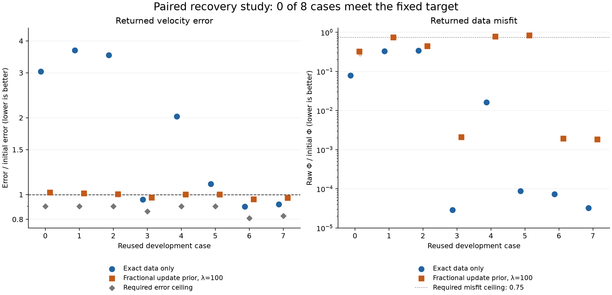

# Classical prior development: audited negative result

The classical fractional update prior meets the fixed recovery target on **0/8 reused cases**, below the required six. All 48 planned returns complete with actual child exit 0 and pass the strict eligibility checks. The prior reduces the large drift of the data-only baseline on five cases, while its best case-median improvement over initialization is 4.10%. It does not pass the development continuation gate.



Large markers show the three-repetition case medians; small points retain all returns. Gray diamonds are the stricter of the initialization and paired-baseline recovery ceilings. These are timing repetitions of reused development inputs, not independent geological samples or confidence intervals. The [full caption](../results/fractional_velocity_prior_development/presentation/prior48_recovery_comparison.caption.txt), [all 48 CSV](../results/fractional_velocity_prior_development/presentation/prior48_all_returns.csv) and [eight-case CSV](../results/fractional_velocity_prior_development/presentation/prior48_case_summary.csv) retain the definitions and values.

| Case | Slice | Initial velocity error | Exact / initial | Prior / initial | Prior Φ/Φ0 |
|---:|---|---:|---:|---:|---:|
| 0 | `gom_148_il_0236` | 14.873% | 3.038039 | 1.020372 | 0.322748 |
| 1 | `gom_148_xl_0768` | 11.757% | 3.673896 | 1.010823 | 0.747025 |
| 2 | `seam_011_il_0522` | 8.370% | 3.522311 | 1.004848 | 0.443595 |
| 3 | `seam_011_xl_0866` | 2.905% | 0.955868 | 0.974406 | 0.00209952 |
| 4 | `gom_151_il_0247` | 16.716% | 2.024101 | 1.002131 | 0.787183 |
| 5 | `gom_151_xl_0857` | 13.378% | 1.101663 | 1.002081 | 0.832344 |
| 6 | `seam_005_il_0596` | 1.737% | 0.898308 | 0.959014 | 0.00193476 |
| 7 | `seam_005_xl_0795` | 1.882% | 0.916572 | 0.970666 | 0.00184569 |

An error ratio of one means the starting model's velocity error. The prior is slightly worse than initialization on five cases and better on three; its case-median ratio spans 0.959014–1.020372. It beats the exact baseline on five cases. All eight prior harm gates pass, but no case meets every recovery condition. For example, case 0's data-only misfit falls to 0.0786 of its initial value while velocity error rises to 3.038 times its initial value. A smaller data residual does not establish better reconstruction.

The fixed continuation rule requires all three eligible repetitions for each case/arm. A successful case requires prior median velocity error ≤0.90 times both initialization and the paired baseline, plus returned common-eight Φ/Φ0≤0.75. At least six cases must succeed, and no prior case median may exceed 1.10 times initial error. Near-initialization stasis is insufficient. The prospective [criteria](../results/fractional_velocity_prior_development/portable_controls/fractional_velocity_prior48_post_audit/criteria.json) are unchanged from before execution.

Both arms use F=Φ/Φ0+λR, with a freshly paid positive initial Φ0, direct native squared-slowness coordinates and the same box bounds. λ is 0 or 100. With q=√(m0/m)−1, the classical penalty is R=[Σq²+16Σedges(qi−qj)²]/(2 N), corresponding to smoothing length 0.1 km and grid spacing 0.025 km. Its gradient is zero at initialization. The source is an established regularization baseline; no new regularizer, certificate or optimizer is claimed by this comparison.

All eight frequencies (0.25,0.5,1,2,2.5,3,3.5,4 Hz), six sources and 20 receivers are retained on the fixed 49×49 damped Dirichlet problem. The actual observation count is 48 blocks per model. The inherited four-frequency geometry is context only. Truth-based recovery metrics are computed after policy return; the supplied initializer is itself derived from synthetic truth, an explicit assumption. The optimizer receives the supplied initialization and observations through its fixed interface.

The full-return allowance is 8 s. The selected accepted point must have completed by 7.5 s from the common run start. Observed complete returns range 7.520710139–7.581680228 s. Preparation, source checks, owner/prior construction, initial merit, all queries/rejections, final actual merit/prior checks, cost snapshot and complete model/metadata serialization are paid before return. Shared bootstrap and postreturn independent assessment are disclosed separately. Only the last chronological eligible composed-F point is returned; truth does not select a checkpoint. Raw Φ may rise while F falls.

Actual consumed time and work are not identical merely because the allowance is shared. Across 24 returns per arm, preparation plus one final native cumulative snapshot gives data-only 17,240 LU/103,440 forward RHS/101,424 adjoint RHS and prior 17,256 LU/103,536 forward RHS/101,664 adjoint RHS. The separate postreturn graph assessment uses 768 LU/4,608 forward RHS per arm. Adapter arithmetic, copying, fingerprint bytes and metric dispatches retain their own units; overlapping snapshots and dispatch counts are not added as RHS. See the [distinct cost summary](../results/fractional_velocity_prior_development/presentation/prior48_cost_summary.json).

The [Linux study](https://github.com/uskutsav-cpu/wavecert-fwi/actions/runs/42549962037) runs at activation commit `e8c144c69e5a5d7b71668329427bd3c88cba26b1`, a registration-only child of successful control commit `9778fd3e998c8eb7dde8915789f5ea612ab71422`. It checks out unchanged production baseline `1983664d5e033dab1b131b80d9aaf2358fc6c5de` separately. Production remains 9f/161 files; the experiment's orchestration workflow is separate. Standard Linux Python 3.11.18/NumPy 2.4.6/SciPy 1.17.1 and single-thread settings are recorded. Earlier Mac timings and the 96-run study are not pooled.

The first control-only job 42548463638 fails because the orchestrator omitted the temporary parent directory: prior 39 and adapter 21 pass; driver 6 pass/1 fixture setup error; launcher is not reached. The exact failed log and artifact remain in controls/cohort_01. A versioned one-line parent-directory fix preserves all numerical sources and thresholds. New control job 42549126689 passes 22 metadata gates plus 39/21/30/50 controls. The subsequent study is first attempt 1, all 48 slots retained, with no retry/resume/pooling. The original V1 source can be reconstructed from its full manifest, its three archived changed files and the 23 byte-identical V2 files.

The prospective retained auditor completes 51,613 checks/1,040 numerical comparisons with zero issues and verifies all 48 eligible. A separate source-informed AI calculation completes 3,902 checks/1,298 comparisons, reconstructing scalar truth, a separable Gaussian initializer, velocity/slowness errors, R/F and all case medians from the actual saved models. It also checks the derived CSV/figure and actual GitHub execution metadata. That reproduction uses no producer/auditor helper, SciPy Gaussian filter or native PDE. The [bound independent review](../results/fractional_velocity_prior_development/independent_actual_review/FINAL_ACTUAL_EVIDENCE_REVIEW_01.json) records its limits.

The core auditor inspects stored source-bound raw-Φ/observation/solve-residual graph evidence; it does not rerun those PDEs. Retained head/tail traces do not reconstruct omitted middle events or live receipt ownership. Ordinary floating-point checks are not formal roundoff enclosures. Repeated crops do not add independent geology; SEAM IDs share one ancestor. This frequency-domain development problem does not establish accepted realistic wave physics or transfer certification to the time-domain model.

To rerun the manufactured/schema checks in a development environment:

```sh
python -B -m pytest -q -s tests/test_prior48_archival_manufactured_reproduction.py
```

The parent verifies 16 frozen computational files and requires 75 unique passing controls. It uses a minimal isolated fixture and no project model inputs or actual study outputs. To reproduce the retained scalar audit, choose an output directory that does not yet exist and lies outside the repository:

```sh
python -B results/fractional_velocity_prior_development/reproduce_retained.py --repo . --output /tmp/wavecert-prior48-replay
```

That command verifies the archive, relocates the retained root terminal observation explicitly, and invokes the frozen scalar auditor. It does not observe a new live remote process, rerun physics or generate new experimental timing. It must reproduce the negative gate and all case/group statistics. The [archive manifest](../results/fractional_velocity_prior_development/archive_manifest.json) binds exact content; raw ZIPs, source copies, failed controls, schedules, GO, terminal records, returned vectors and audits are retained.

The next technical baseline advisory prioritizes an established bounded Gauss–Newton TRF+LSMR implementation with cached Jacobian products. The public merit API exports fields without LU factors; completing the current receiver map costs 8 freshLU+112 receiver RHS per Jacobian point. Covered rows use U.T/1600 without conjugation. Subsequent inner products require paid algebra. The structural rank ceiling≤1,680 over 2,401 parameters is not measured rank, a causal diagnosis or a uniqueness theorem. A better optimizer cannot supply missing information. No GN recovery/runtime result exists. See the [source-bound advisory](../results/fractional_velocity_prior_development/next_baseline_advisory/advisory.json).

All four scientific requirements remain open: useful reconstruction/time benefit at fully paid cost; accepted realistic physics across several independent geological environments; a specific contribution beyond prior certification; and independent reproduction with the student's own interpretation/defense and accurate assistance disclosure. This is extensive AI-assisted technical development, not the student's final research design or competition submission. No national rank, readiness score,10/10 or winning result is established.
