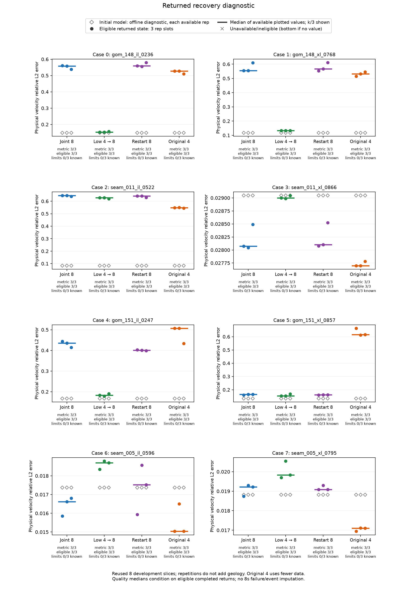

# Frequency continuation: completed development comparison

The tested continuation schedule does **not** resolve velocity recovery. It has lower case-median velocity error than joint-eight-frequency inversion on 5/8 reused cases, but remains worse than the starting model on **7/8**. All four arms are standard exact L-BFGS-B controls; this study establishes neither a new optimizer nor a certificate advantage.

Cohort 02 completed all **96 runs**: eight cases × four arms × three timing repetitions. All 96 complete API returns met the 8-second cap (7.524792542–7.713639625 seconds), with every case/arm retaining 3/3 eligible repetitions. All 144 solver stages stopped on budget; none reached the 2,048/4,096 callback safety caps. This is matched total **time allowance**, with actual consumed times and work counters retained; a shared cap is not exact equality of consumed cost or time-to-target.

## Recovery and data fit

The table divides each three-repetition median relative physical-velocity L2 error by its common initial-model error. Below 1 means an improvement over initialization. Cases 0–7 follow the frozen case order; no case was removed.

| Case | Initial velocity error | Joint 8 / initial | Low 4 → 8 / initial | Restart 8 / initial | Original 4 / initial |
|---|---:|---:|---:|---:|---:|
| 0 | 0.1487319 | 3.75485 | 1.03219 | 3.76274 | 3.54507 |
| 1 | 0.1175682 | 4.72459 | 1.13547 | 4.82011 | 4.5277 |
| 2 | 0.08369824 | 7.70479 | 7.49684 | 7.6631 | 6.54986 |
| 3 | 0.02904735 | 0.966534 | 0.99837 | 0.967514 | 0.953594 |
| 4 | 0.1671647 | 2.60134 | 1.09749 | 2.39533 | 3.03017 |
| 5 | 0.1337824 | 1.23079 | 1.146 | 1.21443 | 4.60187 |
| 6 | 0.01737242 | 0.956771 | 1.07633 | 1.009 | 0.865843 |
| 7 | 0.01881834 | 1.02127 | 1.05384 | 1.01436 | 0.908971 |

Joint 8 is worse than initialization on 6/8 cases, low 4 → 8 on 7/8, restart 8 on 7/8, and original 4 on 5/8. Case 2 remains approximately 7.50 times its initial velocity error under continuation. Case 3's continuation median improves initialization only slightly. The improvement over joint 8 and improvement over initialization are different comparisons.

All methods use a paid common-eight-frequency final/initial data-fit diagnostic. The returned 0.5 / 0.25 ratio counts, out of 24 planned runs per arm, are joint 8: 24 / 20; low 4 → 8: 24 / 21; restart 8: 24 / 20; original 4: 22 / 14. These events occur at the actual eligible return. They are **not first-hit times**, target-stopping runs, or recovery targets. In one original-4 repetition the common-eight objective increases; its own four-frequency optimization uses fewer observations.

[All 96 rows](../results/frequency_continuation_development/figures/all96_runs.csv), [all 32 case/arm groups](../results/frequency_continuation_development/figures/all32_case_method_medians.csv), and [the independent scalar audit](../results/frequency_continuation_development/post_audit_verified_v2/report.json) retain the raw comparisons.



[Common-eight fit](../results/frequency_continuation_development/figures/common8_fit.png) and [actual complete return times](../results/frequency_continuation_development/figures/actual_return.png) are separate figures. Their SVG versions and original overlapping render remain archived. The layout repair leaves both CSVs byte-identical.

## Fixed engineering contract

The native real squared-slowness grid is 49 × 49 at 0.025 km, with the existing Dirichlet/damped discrete operator, six sources and twenty receivers. Available frequencies are 0.25, 0.5, 1, 2, 2.5, 3, 3.5 and 4 Hz. All arms start from the same directly prepared native-m bytes. Joint 8 uses all frequencies; low 4 → 8 first uses the lower four then all eight; restart 8 uses all eight on both sides of the same cold restart; original 4 uses the upper four as a contextual fewer-used-data control.

Every run pays for input/source verification, refinement/smoothing, fresh generation of all 48 observation blocks, cold owner construction, policy queries, final full-eight public objective evaluation, validation/serialization of the returned payload and the complete caller-observed return. Observation generation costs eight factorizations and 48 forward RHS per run. The stage-one ceiling is the absolute global age 3.75 seconds; the single/final-stage ceiling is 7.5 seconds. Early stops transition immediately. Only the last eligible native model transfers; factors, fields, receipts and optimizer history do not cross cold owners. Initial/final metric queries are paid; each owner's final counter snapshot is summed once, with preparation separate and unknown work explicit.

SciPy settings remain maxcor 10, maxls 12, ftol 1e-12 and gtol 1e-10. Its unpassed maxfun default of 15,000 is recorded. The standard exact engine was instrumented to retain bounded traces; paired manufactured checks compare its equations, query sequence, acceptance and clocks with the frozen original. It is not a new optimizer. The 0.5-second return reserve is an allocation, not a guarantee.

All 96 case/arm/repetition slots were saved before project arrays were decoded. The fixed seed is 2026110802, with shuffled arms inside each case/repetition. Source remains **9f30afa…**, 161 production-contract files, unchanged before/after execution. No wavefields or full intermediate model vectors are retained. Head-eight/tail-eight samples, exact counts and ordered commitments omit 4,169 checkpoint and 4,169 step middle records; their hashes do not independently replay those omitted records.

Policy costs end at the complete returned result. Experimental truth/recovery and separate graph objective audits run afterward without feedback; archival compression and plotting also occur afterward. Shared bootstrap/environment observations are retained separately. These are shared-machine timings on an M1 host, not isolated-hardware performance estimates.

## Independent checks and preserved failures

The verified V2 audit reports **41,398 checks, 1,632 scalar numerical comparisons, zero issues**. It independently refines the raw 24-grid velocity with manual half-index bilinear arithmetic and recomputes errors using scalar square roots/math.fsum. It also checks all 392 bound artifacts, source/protocol/input bindings, the full 96/24/32 grouping, both return gates, sampled chronology, paid endpoints, owner/preparation accounting and returned events. It does not rerun PDEs. Producer-side post-return graph solves provide the separate objective/observation checks. NumPy/SciPy and the generic Gaussian initialization filter remain shared dependencies; this is reference-informed AI verification rather than blind human reproduction.

The first scalar audit failed with 2,734 issues because the checker requested the active-prefix field `library_evaluations_trace` for finalized steps, whose frozen exporter writes `library_evaluations_summary`. The failed report/log/source remain intact. V2 changes that one lookup, leaves all criteria/tolerances fixed, and passes 37 controls, including an actual frozen-recorder export and rejection of missing/legacy or unsealed child streams. Both independent source review and the exact one-line delta are retained. See the [failed audit](../results/frequency_continuation_development/post_audit_failed_schema_v1/report.json).

A historical [protocol chronology addendum](../results/frequency_continuation_development/PROTOCOL_CHRONOLOGY_ADDENDUM.json) distinguishes the actual 15-control b982 fixture from the later reviewed 2b49 inventory, which adds only two descriptive count/cap statements. Neither the numerical settings nor the frozen runtime source changed.

Cohort 01 is separately retained: **96 planned, 85 complete, one in flight, ten unattempted**. Its process disappeared after a tool-host/turn interruption; the OS signal and actual exit code are unknown, and no complete receipt exists. Its original last status remains untouched. The [external observation](../results/frequency_continuation_development/cohort_01_external_observation.json) binds all 349 raw files; [all 96 recorded rows](../results/frequency_continuation_development/cohort_01_all96_recorded_rows.csv) expose the incomplete denominator without completed-study credit. Cohort 02 starts a fresh full schedule through a source-reviewed detached supervisor with actual child-wait exit recording. It does not resume, replace, pool or select favorable repetitions from cohort 01.

## Portable software reproduction

On the `research-strengthening` checkout, the new public regression test reproduces all **108 manufactured controls** in five fresh child pytest processes: 17 engine, 24 controller, 15 driver, 15 launcher and 37 scalar-auditor controls. The harness copies the 161 pinned production files and four helper assets into a physical isolated checkout, with no project corpus, module mutation, plugin patch, training or full 96-run experiment. It verifies all source bytes before and after, and checks actual JUnit counts, exit codes and zero skips. The actual driver-control fixture is b982; the later descriptive 2b49 version remains separate.

```bash
python -m pytest -q -s tests/test_frequency_continuation_manufactured_reproduction.py
```

The local parent test passes in 56.61 seconds, with all 108 child controls passing. Its first wrapper run retained 86 passes and 22 setup errors because a temporary parent directory was absent; a one-line wrapper directory fix is versioned with both actual attempts. This is portable software validation, not independent repetition of the inversion study or additional geology. The checkout's pinned source guard deliberately refuses another source version; unmerged `main` is not the tested 9f/161 checkout. Cross-platform CI is reported only after its actual jobs complete.

## Interpretation and next work

The eight slices are reused inspected development inputs. Nominal SEAM labels share original ancestry; three timing repetitions do not create new geology. These experiments show that a lower-frequency schedule, even after a promising initial-linearization diagnostic, is insufficient to establish useful recovery here. They do not establish a cause for every bad reconstruction, convergence of realistic physics, independent-site generalization, a new certification contribution or competition readiness.

The next engineering checks concern which model information the acquisition can constrain and which recovery-oriented classical assumptions are appropriate, alongside the still-open physical boundary/accuracy tests. The independently source/math-reviewed [acquisition ceiling](../results/frequency_continuation_development/acquisition_information_ceiling/MATH_REVIEW.md), with [root review](../results/frequency_continuation_development/acquisition_information_ceiling/ROOT_INDEPENDENT_MATH_REVIEW.json), gives a concrete limitation. Where the complex-symmetric forward matrices are nonsingular, reciprocity reduces 120 complex slots per frequency to at most 105 potentially distinct slots. The eight-frequency real/imaginary Jacobian therefore has rank at most 1,680 over 2,401 unrestricted real parameters, with an ambient linear kernel of dimension at least 721. This is a structural upper/lower bound, not a computed numerical rank, a nonlinear uniqueness result, a feasible null direction at active bounds, or a cause of any particular failed recovery. The original-four measurement submap has the corresponding kernel lower bound 1,561; its controller's common-eight metric queries access additional information. No residual term or weight was dropped, and this classical dimension argument is not a new certification method. The small Overthrust source candidate is a lossy derived demo with unresolved extraction/smoothing provenance; its encoded source has been quarantined without decoding or PDE evaluation, and it adds no validation evidence yet.

All four scientific objectives remain open: useful reconstruction/time benefit at fully paid cost; realistic physics across independent environments; a distinct contribution beyond prior certification; and independent reproduction plus the student's own interpretation/defense and accurate disclosure. These AI-authored engineering controls, audits and figures are recorded in the [assistance record](assistance_record.md); they are not the student's final research question, complete design, interpretation or submission.
