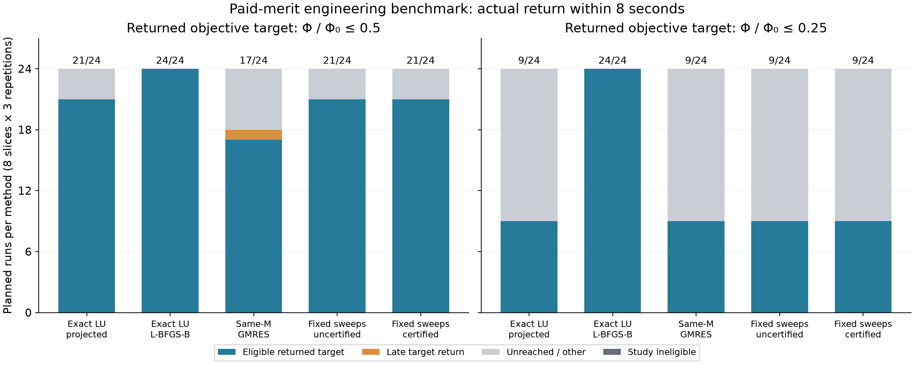
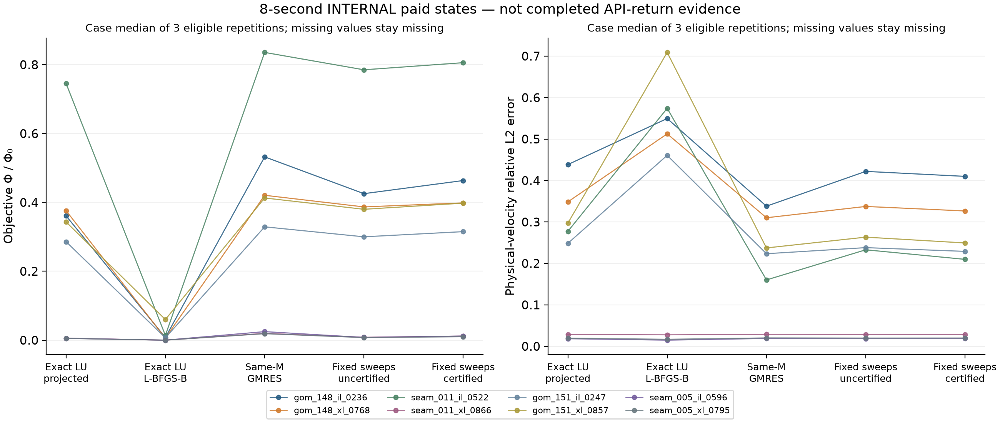
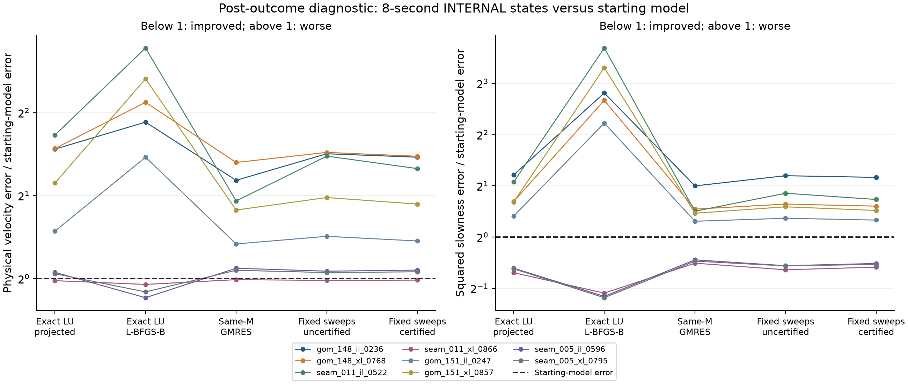

# Paid-merit engineering benchmark: completed development evidence

This is an AI-authored software development and verification record, not a
student paper, final research design, personal interpretation, or a completed
JSHS research contribution. The four scientific requirements remain open.

The fixed 360-run comparison does **not establish a useful certificate advantage**.
Exact cached-LU L-BFGS-B returned both objective targets within budget in 48/48
planned attempts. The certified fixed-sweep method did so in 30/48. Furthermore,
its internal 8-second velocity-error median is worse than initialization on 7/8
cases. Lower reference data misfit does not establish geological recovery.

All outcomes, failures to reach targets, one late target return, raw models,
source snapshots, reviews, launch error and audits are retained in
[`results/paid_merit_engineering_benchmark`](../results/paid_merit_engineering_benchmark).
No default method, rank or reporting criterion was promoted from these results.

## What ran

There are five controls, eight reused validation slices, three timing repetitions
and three modes: an 8-second anytime trajectory, a separate stop at
`Phi/Phi0 <= 0.5`, and a separate stop at `<= 0.25`. This gives 360 planned runs.
All 360 returned and finished their integrity/artifact checks; no engine execution
failure occurred. There were 190 budget stops, five ordinary solver terminations
and 165 objective-target stops. One target stop returned after the 8-second limit
and is ineligible, leaving 164 eligible target events across the 240 target runs.

The model has 49×49 interior unknowns, spacing 0.025 km, six sources, twenty
receivers and four frequencies, or 24 source/frequency blocks. These are old
24×24 velocity slices interpolated onto a finer numerical grid, not new native
high-resolution geology. Rank 64, four repairs, all step/solver settings, eight
identities and seeded method order were frozen before execution. Repetitions and
slices do not create independent sites; the two SEAM provider IDs share one
original ancestor. See the [ancestry correction](ancestry_audit.md).

The live controls are **classical** cached-field methods. They execute no neural
or POD inference. All five use paid sparse-LU reference merit for accepting a
finite step, including the same-M GMRES control. GMRES approximates the missing
gradient fields; it does not replace that common merit oracle.

Every run actually repeats input loading/hash checks, refinement, initialization
and synthetic observation generation inside the global clock. Constructors,
cached fields, rejected trials, certificate work and fallback are paid. The
accepted forward fields and legal LU/gradient reuse are available to the exact
baselines. Bounded progress writes are included. Bootstrap is reported once.
Fresh reference audits and final artifact compression/I/O occur after return
and are separately measured. No preparation cost is added a second time.

## Returned target results

| Method | Half objective, eligible / 24 | Quarter objective, eligible / 24 |
|---|---:|---:|
| Exact LU, projected descent | 21 | 9 |
| Exact LU, L-BFGS-B | 24 | 24 |
| Same-M GMRES, projected descent | 17 | 9 |
| Fixed sweeps, uncertified | 21 | 9 |
| Fixed sweeps, certified | 21 | 9 |

An eligible event requires a positive initial objective, the configured target,
an objective-target stop, complete cost context, **actual start-to-return time
at most 8 seconds**, and completed final study checks. Internal checkpoint times
are not substituted for return times. Unreached/late targets have null event
times; eight seconds is never imputed as an observed success.

For the half-objective target, conditional median return times are 0.690 s for
L-BFGS-B (24 eligible), 0.914 s for exact projected descent (21), 0.627 s for
GMRES (17), 1.688 s for uncertified fixed sweeps (21), and 2.271 s for certified
fixed sweeps (21). These medians condition on different successful subsets.
They cannot rank unconditional speed. The complete CSVs contain every run,
reason and case-level repetition summary. No IID interval or p-value is used.

## Reconstruction and initialization

The original internal-quality figure retains all eight cases and both objective
and physical-velocity error. These states were paid for by their checkpoint
timestamps; they are **internal diagnostics**, not completed-return evidence.

The certified arm has lower internal 8-second velocity error than L-BFGS-B in
5/8 case medians. Calling this a reconstruction success would omit the starting
model: all five of those cases are worse than initialization under every arm.
The certificate improves velocity error over initialization on only 1/8 cases;
L-BFGS-B does so on 3/8. Exact projected descent, GMRES and uncertified fixed
sweeps also improve on only 1/8. No case is omitted and no truth metric controls
any policy or stopping decision.

The following baseline comparison was added **after inspecting the outcomes**.
It is an explicitly post-outcome diagnostic on all 8×5 case/method combinations,
not a newly preregistered primary endpoint. The frozen study and its original
figures are unchanged. Its full CSV, source and caption are retained separately.

The 2,401 real model parameters and 480 complex measurements provide at most
960 real linearized measurement constraints. This dimensional observation
does not prove a specific cause for the measured drift or establish an optimal
regularizer. It does explain why a descent certificate alone cannot imply
identifiable or accurate geology. Priors/parameterization, regularization,
acquisition, frequency content and stopping deserve investigation; the student's
own scientific interpretation and next question are still pending.

## What was independently checked

- A separate receipt auditor passed 232,675 checks of all 360 schedule entries,
  artifact/source/input hashes, paid time nesting, complete return gates,
  denominators, cumulative cost scopes and scalar certificate receipts.
- A separately assembled sparse Helmholtz implementation rebuilt observations
  and evaluated every saved initial/final/four-endpoint slot: 2,160 occurrences,
  708 distinct case/model hashes. Its 12,928 numerical comparisons passed the
  tolerances fixed before inspecting output, with no failures. It shares
  NumPy/SciPy/SuperLU, not the project's merit-oracle assembly.
- Archived offline derivative diagnostics contain 3,429 proposal assessments,
  1,982 available/certified bounds, no observed false certification and no
  assessed bound violation. These are correlated numerical diagnostics, not a
  statistical risk guarantee or a verified floating-point enclosure.

Intermediate direction/gradient/complex-field vectors are hashes in the compact
trajectories. The receipt audit does **not** independently reconstruct their
raw bound arithmetic or all true derivatives. The new saved-model audit
reproduces objective/reconstruction quantities, not those unavailable vectors.
The separately frozen
[raw-vector verification fixture](../results/paid_merit_initial_direction_verification/README.md)
has now recomputed the eight initial states: all eight bounds cover literally,
with zero observed false certifications. Its copied NumPy raw replay passed
1,289 checks and a second checker passed 728; neither reruns a PDE. These
initial-state witnesses must not be represented as replaying all queries or
independently validating coarse stability constants/formal roundoff.

The original 156 production files remain unchanged. Five additive modules give
the current 161-file production-source digest
`9f30afa905cac4e2b3605e98ea85274968ce9797652ede55eab9b0b79811b9da`.

## Scope and next decisions

This study supports retaining a strong exact baseline and separating data fit,
model recovery, directional certification and finite-step acceptance. All controls
already require reference-merit decrease; a certificate cannot claim unique
finite-step monotonic safety from this comparison.

The result does not resolve the separate measured boundary error, transfer the
certificate to Devito/PML, supply independent geological confirmation, establish
priority over the close primary methods, or demonstrate student ownership.
BP2004 acquisition supplies one possible additional numerical ancestor; crops
are not new sites and acquisition is not method validation. The next scientific
choices and interpretation must come from the student, with actual assistance
disclosed under the [current JSHS rules](https://www.jshs.org/wp-content/uploads/2026/08/JSHS-Core-Rules-of-Competition-2026-27.pdf).

For exact reproduction commands, hashes, histories and attribution, see the
[artifact README](../results/paid_merit_engineering_benchmark/README.md).
