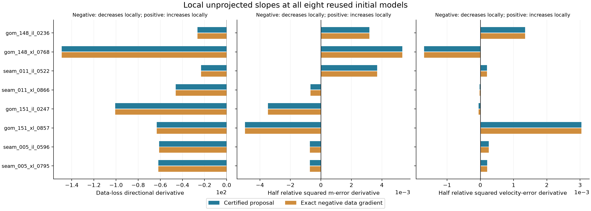
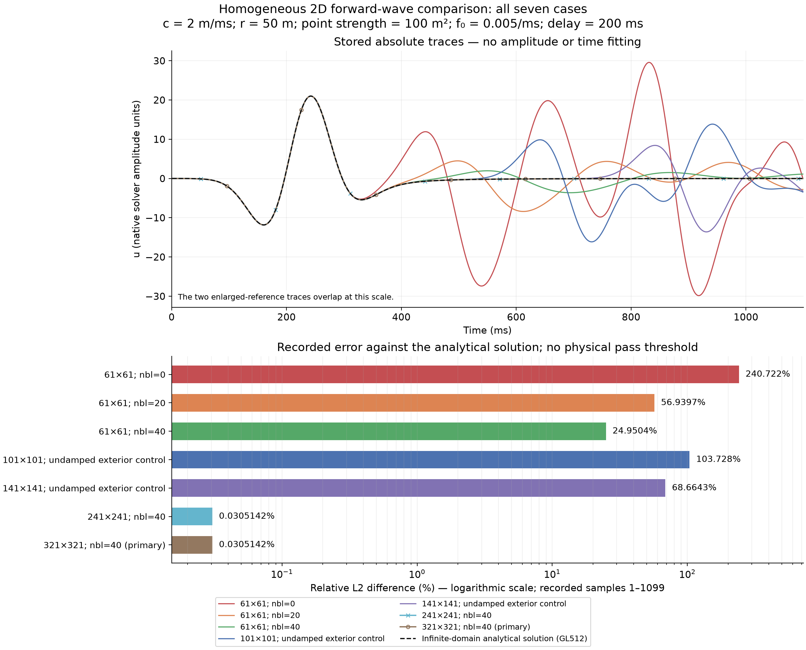

# Recovery directions and analytical wave verification

This AI-authored technical record adds two bounded diagnostics after the
negative paid-cost comparison. It is not a student paper, final research
question/design, personal conclusion or completion of the four research goals.
No new PDE solve or optimizer trajectory was executed for these diagnostics.

## Initial data descent and model recovery

All eight true models and all eight initial models are finite, positive and
inside the original squared-slowness bounds `[1/36, 1]`. None of the initial
parameters is exactly at a bound. These findings rule out exclusion of the
stored truth by those box bounds in this fixture; they do not establish an
adequate physical prior or explain the later failures.

For every initial state, both the actual certified proposal and the normalized
negative reference data gradient decrease data loss to first order. Yet each
has a positive physical-velocity-error slope in **5/8 cases** and a positive
squared-slowness-error slope in **3/8**. Reference-gradient substitution does
not remove these particular local sign oppositions.

The differentiated quantities are **half-relative-squared** errors:

\[
E_m=\frac{\|m-m_*\|_2^2}{2\|m_*\|_2^2},\qquad
E_v=\frac{\|m^{-1/2}-m_*^{-1/2}\|_2^2}{2\|m_*^{-1/2}\|_2^2}.
\]

For an unprojected direction `p`, the derivatives are
`(m-m*)·p / ||m*||²` and
`(v-v*)·[-0.5 m^(-3/2) p] / ||v*||²`. Directions are normalized in native
`m` coordinates. Two centered differences use fixed coordinate-relative caps
`1e-4` and `5e-5`, with positivity enforced without clipping. Numerical near-zero
bands and cancellation allowances are reporting/checking conventions, not
verified sign enclosures.

| Initial case | Velocity-error slope, both directions | m-error slope, both directions |
|---|---|---|
| `gom_148_il_0236` | Positive | Positive |
| `gom_148_xl_0768` | Negative | Positive |
| `seam_011_il_0522` | Positive | Positive |
| `seam_011_xl_0866` | Negative | Negative |
| `gom_151_il_0247` | Negative | Negative |
| `gom_151_xl_0857` | Positive | Negative |
| `seam_005_il_0596` | Positive | Negative |
| `seam_005_xl_0795` | Positive | Negative |

These are local derivatives, not finite clipped steps or forecasts of the whole
inversion. Their case sets differ from the 8-second drift cases:
`gom_148_xl_0768` and `gom_151_il_0247` initially have favorable velocity slopes
but later worsen, while exact L-BFGS-B improves `seam_005_il_0596` and
`seam_005_xl_0795` despite adverse initial velocity slopes. The diagnostics therefore
do not establish cycle skipping, nonuniqueness, a complete causal explanation,
or an optimal remedy. Truth is available only to this offline diagnostic.

The producer passed 4,483 checks. A separate scalar `math.fsum`/`sqrt` audit
passed **67,118 checks and 33,600 numerical comparisons**, with zero issues.
It also rechecked all 1,440 saved internal endpoint instances and all 60
mode/method/budget groups. Modes, repetitions, eligibility and initial fallbacks
remain separate; these are not 1,440 independent geological observations or new
trajectories. All source/input/retained-artifact pins are unchanged.

The [geometry note](../results/initial_recovery_slope_diagnostic/advisories/observation_geometry_structural_bound.json)
also sharpens the elementary row-count upper bound. Six equal-amplitude source
locations are included among twenty receivers. Transpose reciprocity leaves at
most `6*14 + 6*7/2 = 105` complex forward-map classes per frequency, or 420 over
four frequencies. In exact arithmetic, real/imaginary stacking gives
**rank at most 840** for the
linearized real model-to-data map. This is not a computed numerical rank or a
cause of the observed drift. All 480 complex objective slots and their weights
remain in the actual objective; mirrored terms cannot simply be dropped.

## Analytical homogeneous forward reference

The separate timedomain fixture now has an infinite-domain analytical
comparison. The enlarged reference's relative receiver-trace discrepancy is
**0.0305142%** on its actually recorded samples. The small 61×61 physical box
with 40 damping cells still differs by **24.9504%**. All seven cases are kept.

The fixed equation is `c^-2 u_tt - Laplacian(u) = A q(t) delta2(x-xs)` in an
infinite homogeneous plane, with zero initial state. Here `c=2 m/ms`, distance
50 m, cell-area-matched point strength `A=100 m²`, and causal Ricker forcing at
`0.005/ms` with delay 200 ms. No amplitude, source activation or time shift was
fitted. The Green kernel is
`H(s-r/c)/(2*pi*sqrt(s²-(r/c)²))`, consistent with the
[Toronto two-dimensional wave formula](https://www.math.toronto.edu/courses/apm346h1/20181/PDE-textbook/Chapter9/S9.1.html).

Fixed 128/256/512-point Gauss–Legendre integrations use a `cosh` substitution and
the [NIST Jacobi-matrix construction](https://dlmf.nist.gov/3.5.vi). A separate
post-audit uses `s=r/c+z²`, scalar Ricker evaluation and adaptive QUADPACK.
Its curve agrees with the saved 512-point curve at **1.8515e-15 relative L2**;
all 228 audit checks and all seven independently recomputed metrics pass.
This is ordinary numerical agreement, not a rigorous integration enclosure.

Only indices 1–1099 were computed by the original recorder. Sentinel slots
0/1100 are excluded by the frozen mask; full 1101-sample arrays remain saved.
The continuum's causal source has nonzero value at zero, whereas the discrete
scheme starts with `u[0]=u[1]=0` and omits source sample zero. That startup
mismatch, finite-grid source/discretization effects and finite-domain effects
remain. The receiver is only five grid spacings from the source. This diagnostic
does not isolate those errors or measure an intrinsic reflection coefficient.

`physical_quality_pass` remains null: no physical acceptance tolerance has been
chosen. This is one homogeneous forward-control fixture. It does not establish
heterogeneous or independent geological validation, PML/free-surface/adjoint
correctness, inverse recovery or transfer of the frequency-domain certificate.
The recovery and Green diagnostics concern different backends; one is not a
demonstrated cause of the other.

## What the next comparison must respect

The [primary-method advisory](../results/initial_recovery_slope_diagnostic/advisories/primary_FWI_recovery_methods.json)
distinguishes established continuation/acquisition, Gauss–Newton/LM, model-prior
constraints and WRI from gradient-error certification. None is a newly invented
method here or a guaranteed remedy. Truth-derived prior radii from a published
synthetic example cannot be borrowed as deployable information for this project.

A standard [velocity-parameterized exact baseline component](../results/velocity_parameterized_baseline_candidate/README.md)
has passed 31 manufactured controls and independent AI source review as
software support, motivated by these already inspected development outcomes.
It has no project-data performance/recovery result. A future paired comparison
needs explicit coordinate/initial-state conversion and fully paid costs; the
existing slowness helper must not mistake velocity vectors for slowness models.
The student must still determine and defend their own scientific question,
interpretation, comparison choices and actual contributions. No new national
rank or 10/10 assessment follows from these diagnostics.

Exact source, protocols, controls, histories, post-audits and reproduction commands:
[recovery artifact](../results/initial_recovery_slope_diagnostic/README.md) and
[Green artifact](../results/analytic_green_verification/README.md).
